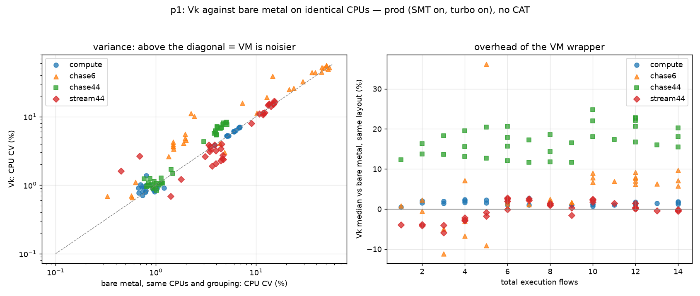
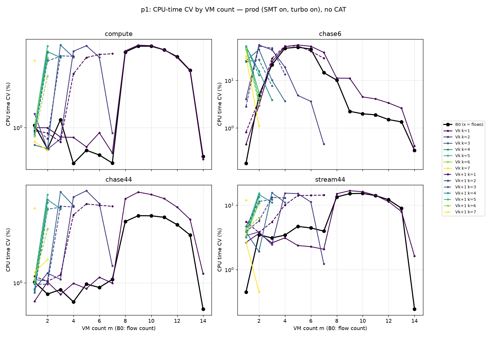

# 2026-11-14~16 KVM 감싸기 채점 분산 실험 (codedang8, socket 0)

## 결론

채점 실행 흐름(libjudger alpha.4 + 사전 컴파일 바이너리)을 raw QEMU/KVM VM으로 감싸도 **실행 시간 분산은 줄지 않았다.** VM의 CPU 시간 분산은 같은 CPU·같은 묶음으로 배치한 bare metal과 거의 같았고, 오히려 대부분의 셀에서 약간(0.1 pp 내외) 컸다. 분산을 결정한 것은 감싸는 방식(VM 수 m, VM당 흐름 수 k)이 아니라 **socket 0에서 동시에 실행되는 총 흐름 수와 그들이 공유하는 자원**(SMT 형제 스레드, L3, 메모리 대역폭)이었다.

- 연산 위주(`compute`): VM 오버헤드 +0.7~1.5 %, CV 차이 ≈ 0. prod 정책에서 총 흐름 8~13개 구간의 CV 5~7 %는 SMT 형제 공유 때문이며 VM/bare 동일.
- L3 위주(`chase6`): 총 흐름 3~7개에서 CV 20~55 %(L3 thrash 경계). VM에서도 같은 위치에서 같은 크기로 나타남.
- DRAM 지연(`chase44`): VM이 **일관되게 15~19 % 느림**(4 KiB 게스트 페이지의 2단계 페이지 워크로 추정). 분산은 동일.
- DRAM 대역폭(`stream44`): 오버헤드 0~3 %, 흐름 수에 따라 중앙값이 선형으로 증가(455 → 854 ms, quiet). VM/bare 동일.
- VM에 여분 vCPU(k+1)를 줘도 이득이 없었다. SMT on에서는 흐름이 형제 스레드로 옮겨 가며 분산이 늘어나는 경우가 있었다(stream44 최대 +12 pp).
- VM별 CAT는 VM이든 bare metal이든 같은 효과였다: `chase6`의 일부 셀에서 분산을 크게 줄이는 대신 중앙값을 최대 2~3배 늘렸고, 나머지 워크로드에는 영향이 없었다.

즉 KVM은 이번 측정 범위에서 **분산 대책이 아니며**, 4차 테스트의 구조적 판단("VM은 같은 코어·L3·메모리를 공유하므로 해법이 아니다")을 실측으로 확인했다. 분산을 줄인 것은 클럭/SMT 정책(quiet에서 compute CV 0.5 %로 평탄)이었고, 이는 VM 없이도 같다.

## 실험 조건

- 서버: `codedang8`(2× Xeon E5-2620 v4), kernel 7.0.0-34-generic, **socket 0만 사용**, 메모리 node 0 바인딩.
- 실행 흐름: `judger-bench` → stock alpha.4 `libjudger.so`(`2c9a4da8…`, production-compat) → 사전 컴파일 바이너리. 컴파일 제외.
- 워크로드(한 run 안에서는 모두 동일): `compute`(cpp-runtime-v1), `chase6`(6 MiB pointer chase), `chase44`(44 MiB chase), `stream44`(44 MiB 순차 읽기). 4차 테스트와 같은 fixture.
- 항상 바쁜 closed loop: 워밍업 3회 후 barrier, 모든 흐름이 공통 활성 구간에서 52개 이상 샘플을 가질 때까지 정지 신호를 보내지 않음. 통계는 `[max(first start), min(last end)]`에 완전히 포함된 샘플만 사용.
- 배치(arm), 모든 arm이 같은 폭이면 같은 논리 CPU를 사용:
  - B0: bare metal, 흐름당 CPU 1개 고정
  - B1: bare metal, k개 CPU 묶음 m개, 흐름은 묶음 안에서 이동
  - Vk: VM m개 × vCPU k개, VM당 흐름 k개
  - Vk+1: VM m개 × vCPU k+1개, VM당 흐름 k개
  - 슬롯 순서: SMT on은 코어 1–7 다음 형제 17–23(housekeeping 0,16), SMT off는 1–7(housekeeping 0). 오버커밋 없음.
- VM: `qemu-system-x86_64` 8.2.2, q35, `-cpu host`, 네트워크 없음, 호스트 커널 직접 부팅, 읽기 전용 ubuntu-base 24.04.4 rootfs, PID 1은 셸 init(systemd 없음), virtio-serial로 제어/샘플 전송. 게스트 메모리 `1024+256·k` MiB, node 0 고정·prealloc, **THP 비활성화로 4 KiB 페이지**(전 run `AnonHugePages=0` 확인). vCPU 스레드는 QMP로 1:1 고정.
- 단계(각 3회, 회차마다 재부팅, 회차 내 순서 무작위):

| 단계 | 정책 | CAT | arm | run/회차 |
| --- | --- | --- | --- | ---: |
| p1 | prod: SMT on, turbo on | 없음 | B0 B1 Vk Vk+1 | 356 |
| p2 | quiet: SMT off, turbo off | 없음 | B0 B1 Vk Vk+1 | 164 |
| p3a | prod | 그룹별 균등·비중첩 L3 way | B0 B1 Vk | 272 |
| p3b | quiet | 그룹별 균등·비중첩 L3 way | B0 B1 Vk | 128 |

총 2,760 run, **전부 ok**(degraded 0, 실패 샘플 0). 2026-11-14 17:40 ~ 11-16 22:02 KST.

## 측정 신뢰성

| 항목 | 값 |
| --- | --- |
| 게스트 steal time | 최대 0.18 % |
| 호스트 vCPU 스레드 run-queue 대기 | 최대 0.18 % |
| 게스트 4 KiB 페이지 | 전 run AnonHugePages 0 KiB |
| 게스트/호스트 시계 오프셋 변화 | 최대 9 ms(구간 경계 보정에만 사용) |
| VM 부팅→READY | 중앙값 3.2 s, 최대 9.6 s(측정 구간 밖) |
| 회차 간 셀 중앙값 범위 | 중앙값 0.26~0.64 %, p90 3.4~9.4 %(chase6가 꼬리) |

게스트 커널은 `CONFIG_PARAVIRT_TIME_ACCOUNTING`이 꺼져 있어 호스트 선점이 게스트 CPU 시간에 포함되지만, steal·대기가 0.2 % 미만이어서 영향은 무시할 수 있다.

## 결과 1 — 단독 실행(흐름 1개) 중앙값, CPU 시간 ms

| 정책 | 워크로드 | bare (B0) | VM (Vk k=1) | 차이 |
| --- | --- | ---: | ---: | ---: |
| prod | compute | 381 | 383 | +0.5 % |
| prod | chase6 | 362 | 365 | +0.8 % |
| prod | chase44 | 376 | 422 | **+12.2 %** |
| prod | stream44 | 383 | 368 | −3.9 % |
| quiet | compute | 544 | 548 | +0.7 % |
| quiet | chase6 | 442 | 452 | +2.3 % |
| quiet | chase44 | 407 | 475 | **+16.7 %** |
| quiet | stream44 | 455 | 471 | +3.5 % |

## 결과 2 — 같은 CPU·같은 묶음에서 VM vs bare metal

Vk(k, m)을 B1(k, m)과, k = 1이면 B0(m)과 비교. 모든 (k, m) 셀의 중앙값 [최소, 최대].

| 단계 | 워크로드 | 셀 | 중앙값 오버헤드 | CV 차이 (pp) | VM CV ≤ bare CV |
| --- | --- | ---: | --- | --- | ---: |
| p1 | compute | 34 | +1.4 % [+0.5, +2.7] | +0.1 [−0.3, +0.6] | 9/34 |
| p1 | chase6 | 34 | +2.5 % [−11.2, +36.2] | +2.5 [−3.0, +24.3] | 5/34 |
| p1 | chase44 | 34 | +17.0 % [+11.6, +24.7] | +0.3 [−0.2, +3.4] | 8/34 |
| p1 | stream44 | 34 | +0.1 % [−5.9, +2.8] | −0.4 [−2.3, +2.0] | 20/34 |
| p2 | compute | 16 | +0.9 % [+0.6, +0.9] | +0.0 [−0.0, +0.2] | 1/16 |
| p2 | chase6 | 16 | +1.0 % [−17.7, +6.9] | +1.7 [−27.5, +15.4] | 6/16 |
| p2 | chase44 | 16 | +17.2 % [+12.6, +21.6] | +0.0 [−0.1, +0.2] | 7/16 |
| p2 | stream44 | 16 | +2.2 % [−0.3, +4.7] | +0.1 [−0.5, +0.9] | 5/16 |

p3a/p3b(CAT)도 같은 양상이다(`tables.md`). realTime 기준 오버헤드는 compute 0 %, chase44 +15~16 %.

## 결과 3 — VM 수·VM당 흐름 수에 따른 분산

CV는 (k, m) 조합이 아니라 **총 흐름 수 k·m**을 따라간다. prod·compute 예(CPU CV %):

| 총 흐름 | 1–7 | 8 | 9 | 10 | 12 | 14 |
| --- | --- | --- | --- | --- | --- | --- |
| B0 | 0.7–1.2 | 6.0 | 6.8 | 6.8 | 5.3 | 0.7 |
| Vk k=1 | 0.8–1.0 | 6.1 | 7.0 | 6.9 | 5.3 | 0.7 |
| Vk k=2 |  | 6.1 (m=4) |  | 6.9 (m=5) | 5.3 (m=6) | 0.9 (m=7) |
| Vk k=7 | 0.9 (m=1) |  |  |  |  | 0.8 (m=2) |

8~13개에서는 일부 흐름만 SMT 형제와 코어를 공유해 이봉 분포가 되고, 14개에서 모두 공유하면 다시 평탄해진다(4차 테스트의 24워커 이봉 분포와 같은 현상). `chase6`는 총 흐름 3~7개에서 CV 20~55 %로 정점을 찍는데, VM 1개에 흐름 4개(Vk k=4 m=1: 51.7 %)든 bare 4개(B0: 47.4 %)든 같다. 전체 k × m 표와 그림은 `tables.md`, `charts/*-cv-by-vmcount.png`, `charts/*-cv-heatmap.png`.

## 결과 4 — 여분 vCPU(Vk+1)

| 단계 | 워크로드 | 중앙값 변화 | CV 차이 (pp) |
| --- | --- | --- | --- |
| p1 | compute | +0.5 % [−2.3, +8.5] | −0.0 [−1.9, +5.0] |
| p1 | chase6 | +2.1 % [−39.2, +22.7] | −1.2 [−17.6, +4.3] |
| p1 | chase44 | +3.3 % [−0.8, +11.7] | +0.0 [−2.4, +5.2] |
| p1 | stream44 | +1.4 % [−6.8, +16.4] | +0.8 [−4.3, +12.3] |
| p2 | 전체 | ±1 % 이내(chase6 일부 제외) | ±0.2 pp 이내(chase6 제외) |

SMT off에서는 효과가 없고, SMT on에서는 여분 vCPU가 다른 VM과 형제 스레드를 공유하는 배치가 생겨 분산이 늘 수 있다.

## 결과 5 — VM별 CAT

| 정책 | arm | chase6 중앙값 변화 | chase6 CV 차이 | 다른 워크로드 |
| --- | --- | --- | --- | --- |
| prod | B0 / B1 / Vk | +1.1 / +0.1 / +1.0 % (최대 +178 / +160 / +232 %) | 최소 −48 / −43 / −54 pp | ±1 % |
| quiet | B0 / B1 / Vk | +22.5 / +5.5 / +6.0 % (최대 +116 / +140 / +170 %) | 중앙값 −21 / −11 / −9 pp | ±1 % |

CAT의 효과는 VM 여부와 무관했다. 그룹당 way가 6 MiB 작업 집합보다 작아지면 결과가 "안정적으로 느려지는" 11/06 결과가 재현됐다.

## 11/06 참고 기준 통과 셀 수

자기 단독 대비 tail drift ≤ 5 %, CV ≤ 5 %, 실패 0. 팀 기준이 아니며 기록용이다.

| 단계 | compute (B0/B1/Vk/Vk+1) | chase6 | chase44 | stream44 |
| --- | --- | --- | --- | --- |
| p1 | 2/14, 6/20, 7/34, 6/21 | 1/14, 0/20, 1/34, 1/21 | 2/14, 6/20, 7/34, 6/21 | 1/14, 0/20, 1/34, 0/21 |
| p2 | 7/7, 9/9, 16/16, 9/9 | 1/7, 0/9, 3/16, 1/9 | 4/7, 7/9, 16/16, 9/9 | 2/7, 6/9, 7/16, 6/9 |

chase44에서 Vk가 B0보다 많이 통과하는 것은 VM 단독 기준값이 이미 15 % 이상 느리기 때문이다(상대 기준의 착시). 절대 시간은 VM이 항상 느리다.

## 해석과 한계

- KVM은 vCPU 고정·메모리 바인딩을 제공하지만, 그것은 bare metal의 `numactl`/cpuset으로도 똑같이 얻을 수 있고(B1 대조군) 공유 L3·메모리 대역폭·SMT 형제 간섭은 VM 경계를 그대로 통과한다. 이번 데이터에서 VM 고유의 분산 감소 효과는 관측되지 않았다.
- VM은 메모리 집약 코드에 고정 비용(chase44 +15~19 %)을 더한다. hugepage 백킹은 이번 범위 밖이며, 쓰면 이 비용은 줄 수 있으나 분산 결론은 바뀌지 않을 것으로 본다(분산은 공유 자원에서 오므로).
- 측정은 codedang8 socket 0 한 곳, 동종 워크로드, 실행만(컴파일 제외), production-compat Judger다. 혼합 이웃·실제 Iris 큐·near-limit verdict는 검증하지 않았다.
- pooled CV는 회차 간 차이를 포함한다. 회차별 중앙값은 `summary.json.gz`의 `round_medians`에 있다.

## 산출물

- 방법: `docs/KVM-VARIANCE.md`
- 스크립트: `scripts/kvm/`(runner, guest init, planner, driver, analyze, plot, report)
- 셀 표: `results/kvm-variance/cells.csv`, `tables.md`, 전체 요약 `summary.json.gz`
- 그림: `results/kvm-variance/charts/`
- 원자료: codedang8 `/var/tmp/iris-kvm/runs/<phase>-r<round>/`(Git 제외)
